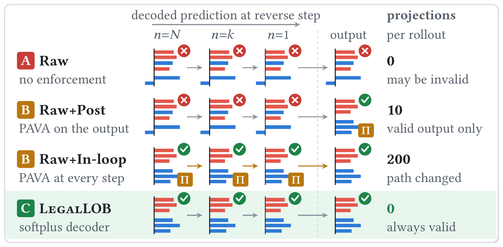
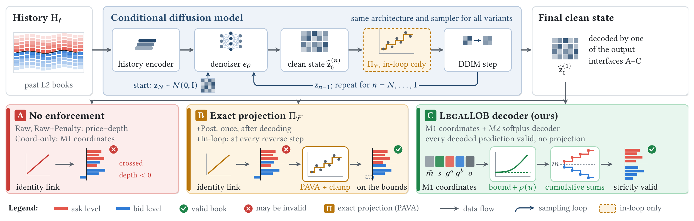
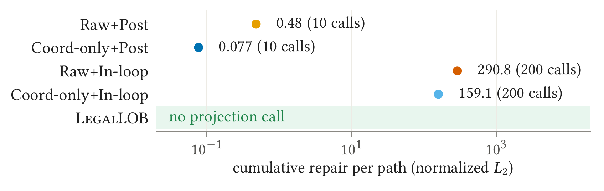
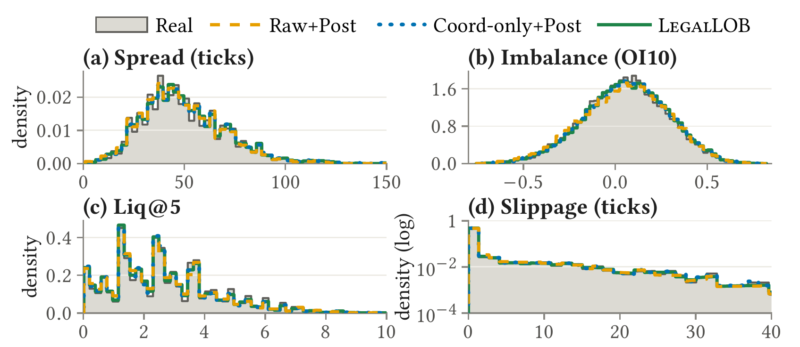

<p align="center">
  <picture>
    <source media="(prefers-color-scheme: dark)" srcset="assets/logo-dark.png">
    
  </picture>
</p>

<h1 align="center">LegalLOB: Generating Structurally Valid Level-2 Limit Order Book Trajectories with Diffusion Models</h1>

<p align="center">
  <a href="#-引用"></a>
  
  
  <a href="REPRODUCE.md"></a>
  <a href="https://github.com/moderncavemann/LegalLOB/stargazers"></a>
  <a href="https://github.com/moderncavemann/LegalLOB/forks"></a>
  <a href="https://hitscounter.dev/history?url=https%3A%2F%2Fgithub.com%2Fmoderncavemann%2FLegalLOB"></a>
</p>

<p align="center">
  <a href="README.md">English</a> | <a href="README.zh-CN.md"><strong>简体中文</strong></a>
</p>

> **作者：** Guanghao Wu<sup>1,\*</sup>, Yixuan Xu<sup>2,\*</sup>, Shoujin Wang<sup>1,†</sup><br>
> <sup>1</sup>University of Technology Sydney &nbsp; <sup>2</sup>Independent Researcher, Sydney<br>
> <sup>\*</sup>共同第一作者 &nbsp; <sup>†</sup>通讯作者<br>
> 7th ACM International Conference on AI in Finance (ICAIF '26), Milan, Italy

LegalLOB 是一个生成 Level-2 限价订单簿（LOB）轨迹的条件扩散模型，它生成的订单簿**在构造上就是合法的**。一个合法的订单簿要满足三条规则：最优卖价高于最优买价，各档价格保持有序，挂单深度非负。LegalLOB 用这些规则所约束的量来描述订单簿，再通过 softplus 链接和累加把它们解码回去，因此它解码出的每一个订单簿，包括采样过程中每一步的 clean-state 预测，都无需惩罚、拒绝或投影就是合法的。

- 🧱 **约束对齐的表示：** 用一个自由的中间价，加上价差、相邻档位之间的价格间隔和各档深度来描述订单簿，每条规则都变成对单个数的下界约束。
- ➕ **Softplus 解码器：** softplus 链接让每个数保持在下界之上，累加重建两侧的价格阶梯；扩散模型的训练目标和采样器都不需要改动。
- 🔁 **整条采样路径都合法：** guidance、提前停止或递归模拟可以直接读取任意一步的解码预测，不必先修复。

<sub>名字中的 “Legal” 指结构上合法，与法律合规无关。</sub>

## 🧭 为什么需要 LegalLOB？

扩散模型可以为模拟和压力测试生成看起来合理的未来 Level-2 订单簿，但它输出的价格和深度没有任何约束。即使去噪误差很低，模型也可能生成买卖价交叉、档位倒挂或深度为负的订单簿；在用于风险计算、下游模型或递归模拟的下一步之前，这些订单簿都必须被拒绝或修复。训练时加惩罚只能让违规变少，无法杜绝。用 pool-adjacent-violators 算法（PAVA）做精确投影可以低成本地修复订单簿，但只修复交给它的那一个：采样过程中的每个中间预测在被读取时都要单独投影一次，而在采样器内部投影又会改变采样路径。

<p align="center">
  
</p>

<p align="center"><sub>采样路径上的合法性（示意图）。每一行给出反向第 <i>N</i>、<i>k</i>、1 步解码出的 clean-state 预测和最终输出，以及每条 100 步 GOOG-Event 递归生成所需的精确投影（Π）次数。事后 PAVA 只让最终输出合法；循环内 PAVA 投影每一个预测，并把修复结果反馈回采样；LegalLOB 不做投影，处处合法。</sub></p>

### 🚫 违规是常态

修复之前，无约束的变体在每个数据集上都有大约一半甚至更多的快照不合法。只换成约束对齐的坐标并不能消除违规，起作用的是 softplus 解码器。

| 变体 | AAPL-1Hz | AMZN-1Hz | GOOG-Event | GOOG-1Hz |
| --- | ---: | ---: | ---: | ---: |
| **LegalLOB**（约束对齐坐标 + softplus 解码器） | **0** | **0** | **0** | **0** |
| Coord-only（约束对齐坐标，恒等链接） | 99.9 | 48.3 | 78.5 | 59.3 |
| Raw（直接输出价格和深度） | 100.0 | 59.9 | 84.9 | 70.1 |
| Raw+Penalty（训练惩罚） | 100.0 | 59.6 | 84.4 | 69.4 |

<p align="center"><sub>修复前不合法快照的比例（%），三个独立训练的模型取平均；每次评估包含 6,400 段历史，每段生成 10 个未来快照。</sub></p>

### 🎯 三个挑战

- **耦合的约束。** 在原始价格坐标里，订单簿是否交叉取决于两个价格，价格阶梯是否有序取决于每一对相邻档位。
- **不依赖外部修复的合法性。** 神经网络总可能输出低于下界的值；合法性必须在不改变扩散训练目标、不在采样中加投影、也不让生成分布塌缩的前提下成立。
- **保证从哪里来、有什么用。** 零违规也可能来自更容易的坐标或更强的网络，而精确投影同样能给出合法的最终输出。

## ⚙️ 方法概览

LegalLOB 沿用条件扩散模型本身：DiffLOB 风格的去噪网络，用常规的噪声预测目标训练，用 DDIM 采样；它只改变把 clean-state 预测解码成订单簿的方式。

<p align="center">
  
</p>

<p align="center"><sub>所有变体共享去噪网络结构、噪声预测目标和 DDIM 采样器（上），区别只在于如何把 clean-state 预测解码成订单簿（下）：(A) 恒等链接；(B) 恒等链接后接精确投影，只在解码后投影一次或在每一步反向采样都投影；(C) LegalLOB 的 softplus 解码器。</sub></p>

**1. 约束对齐的表示。** 以最后一个观测订单簿的中间价为锚点，每个未来订单簿由中间价偏移、买卖价差 $s$、相邻卖档和买档之间的价格间隔 $g^a_k$、$g^b_k$ 以及各档深度 $v$ 描述。每条排序规则都变成对单个坐标的下界约束，中间价则不受约束。

**2. Softplus 解码器。** 记 softplus 函数 $\rho(u)=\log(1+e^u)$，最小价差为 $\delta$，最小档位间隔为 $\gamma$，深度下限为 $\epsilon_v$，解码器把网络输出 $u$ 映射为

$$
s=\delta+\rho(u_s),\qquad g^a_k=\gamma+\rho(u^a_k),\qquad g^b_k=\gamma+\rho(u^b_k),\qquad v=\epsilon_v+\rho(u_v),
$$

$$
a^{(1)}=m+\tfrac{s}{2},\qquad b^{(1)}=m-\tfrac{s}{2},\qquad a^{(k)}=a^{(1)}+\sum_{j=2}^{k}g^a_j,\qquad b^{(k)}=b^{(1)}-\sum_{j=2}^{k}g^b_j .
$$

其中 $m$ 是锚点中间价加上生成的中间价偏移。在精确算术下，这是一个到合法订单簿集合内部的光滑双射：任何网络输出都会被解码成严格合法的订单簿，它的逆映射用来编码训练目标。实验中 $\delta=\gamma$ 取一个最小报价单位（tick），$\epsilon_v=0$。

**3. 受控对比。** 各个基线使用相同的去噪网络结构、超参数、数据和训练预算，区别在于在哪里施加合法性：不施加（Raw、Coord-only）、通过训练惩罚（Raw+Penalty）、在采样结束后做精确 PAVA 投影（+Post），或在每一步去噪时都做精确 PAVA 投影（+In-loop）。

表示和解码器对应 [`genlob/utils/legal_lob.py`](genlob/utils/legal_lob.py) 中的 `LegalLOBTransform`，同一文件里的 `MatchedLOBTransform` 是 Coord-only 基线；合法性检查和精确 PAVA 投影在 [`genlob/utils/physics.py`](genlob/utils/physics.py)。

## 📊 实验结果

LegalLOB 是唯一在四个数据集上修复前都零违规的学习模型；在 100 步 GOOG-Event 递归生成中，也只有它的每一个解码预测都能不经投影直接使用。它保留了无约束模型 99.6% 的生成速度。这一保证在保真度上并非没有代价：最强的修复基线，即对 Coord-only 模型做事后 PAVA（Coord-only+Post），在 36 组保真度比较中领先 24 组；而在 GOOG-Event 上，LegalLOB 的概率评分与它只相差几个百分点。

### 🔁 递归生成中的中间状态

一个 fail-closed 的监控器在 100 步 GOOG-Event 递归生成的每一步去噪和每个分块终点读取解码预测，并拒绝任何不合法的快照。

<table>
  <thead>
    <tr>
      <th align="left">方法</th>
      <th align="center">每条路径的<br>投影次数 ↓</th>
      <th align="center">累计<br>修复量 ↓</th>
      <th align="center">被拒绝的快照<br>请求（%）↓</th>
      <th align="center">出现拒绝的<br>路径（%）↓</th>
    </tr>
  </thead>
  <tbody>
    <tr><td>Coord-only+Post</td><td align="center">10</td><td align="center">0.077</td><td align="center">51.9</td><td align="center">100</td></tr>
    <tr><td>Coord-only+In-loop</td><td align="center">200</td><td align="center">159.1</td><td align="center"><ins>1.0 × 10<sup>−4</sup></ins></td><td align="center"><ins>0.19</ins></td></tr>
    <tr><td><b>LegalLOB</b></td><td align="center"><b>0</b></td><td align="center">无需投影</td><td align="center"><b>0</b></td><td align="center"><b>0</b></td></tr>
  </tbody>
</table>

<p align="center"><sub>三个模型取平均，每个模型 640 段历史、3 个采样种子（每种方法共 1,150 万次快照请求）。拒绝率按各方法自身的投影之后统计。累计修复量：投影沿一条路径造成的归一化 L2 改动之和。Coord-only+Post 只修复分块终点，约一半的中间请求仍不合法；Coord-only+In-loop 修复每一次请求，但改变了采样路径。</sub></p>

### ⏱️ 计算成本与概率预测

<table>
  <tr>
    <td width="45%" valign="top">

| 方法 | 快照/秒 ↑ |
| --- | ---: |
| Raw（无约束） | 1300.0 |
| Raw+Post | <ins>1237.9</ins> |
| Raw+In-loop | 709.4 |
| Coord-only+Post | 1237.8 |
| **LegalLOB** | **1294.9** |

<sub>在三个 1-Hz 数据集上生成 1,280 个未来快照（DDIM-20，Apple M3 Ultra）。只在输出合法的方法之间排名。</sub>

  </td>
  <td width="55%" valign="top">

| 方法 | Energy score ↓ | CRPS ↓ | Variogram ↓ |
| --- | ---: | ---: | ---: |
| Persistence | 0.4567 | 0.1832 | 0.1128 |
| Raw+Post | 0.5867 | 0.2768 | 0.0874 |
| Coord-only+Post | **0.3095** | **0.1452** | **0.0826** |
| **LegalLOB** | <ins>0.3157</ins> | <ins>0.1513</ins> | <ins>0.0832</ins> |

<sub>GOOG-Event，512 段历史，每段 32 个样本。LegalLOB 的集合最分散；LegalLOB 和 Coord-only+Post 的区间覆盖率都不完全准确。</sub>

  </td>
  </tr>
</table>

<sub><b>粗体</b>：最优；<ins>下划线</ins>：次优。三个模型取平均。</sub>

### 📈 保证的代价与收益

<table>
  <tr>
    <td width="50%" align="center" valign="top">
      <a href="assets/burden.png"></a><br>
      <sub><strong>每种方法需要多少修复？</strong> 每条 100 步 GOOG-Event 路径的累计修复量（对数坐标）和投影次数。循环内投影每次移动状态的幅度远大于事后投影；LegalLOB 不需要投影。</sub>
    </td>
    <td width="50%" align="center" valign="top">
      <a href="assets/marginals.png"></a><br>
      <sub><strong>保证会扭曲订单簿吗？</strong> GOOG-Event 上价差、深度不平衡、Liq@5 和滑点的分布：生成的分布与真实分布（灰色）高度重合。</sub>
    </td>
  </tr>
</table>

在随机生成方法中，LegalLOB 在三个数据集上的 microprice 距离最小，在两个 GOOG 数据集上的 Liq@5 距离最小；但 Coord-only+Post 在其余大多数保真度指标上更好，在部分时间序列诊断上差距明显。在三个 1-Hz 数据集上，LegalLOB 的点误差也是随机生成方法中最高的。

### 🤔 什么时候用 LegalLOB

如果只用最终输出的订单簿，事后 PAVA 是自然的默认选择：它是精确的，只增加约 5% 的运行时间，而且用在 Coord-only 模型上时在大多数保真度指标上领先。当更早的状态也要被读取时，LegalLOB 才体现价值，例如每一步去噪都对 clean-state 预测打分的 guidance、在延迟预算下提前停止的 anytime 采样，或者递归模拟中的监控器。这时投影需要每读一次就调用一次，而把修复后的状态反馈给采样器又会改变生成路径；LegalLOB 的预测生成出来就是合法的，梯度也能通过光滑的解码器传回。

## 🧪 数据集

| 设置 | 数据 | 数据集 ID |
| --- | --- | --- |
| **AAPL-1Hz、AMZN-1Hz、GOOG-1Hz** | Nasdaq 公开的 TotalView-ITCH 样本：2019 年六个交易日中每秒最后一个合法的常规交易时段订单簿（训练 1 月 30 日、3 月 27 日、7 月 30 日；验证 8 月 30 日；测试 10 月 30 日、12 月 30 日）；每只股票 140,400 个快照。 | `PUBLIC_ITCH_2019_SAMPLES_<TICKER>_1s` |
| **GOOG-Event** | Databento XNAS.ITCH MBP-10：2019 年 1 月 30 日常规交易时段 GOOG 的每一次合法订单簿更新，按时间顺序 70/15/15 划分，分界处留 100 行间隔；共 856,984 个快照。 | `GOOG_databento_20190130_mbp10_rth_v2` |

所有设置都使用每侧前十档、50 个历史快照和 10 个未来快照，价格以十个最小报价单位为一个单位，深度取平方根并在训练集第 99 百分位处截断。市场数据不随仓库分发：脚本会下载公开的 ITCH 样本，Databento 数据需要用你自己的 API key 获取。

## 🚀 快速开始

需要 Python 3.10+ 和 PyTorch 2（CUDA、MPS 或 CPU），请先安装适合你平台的 PyTorch。下面的例子在 GOOG-1Hz 上训练并评估 LegalLOB。

```bash
git clone https://github.com/moderncavemann/LegalLOB.git
cd LegalLOB
pip install -r requirements.txt

# 数据：2019 年六个公开的 Nasdaq ITCH 样本日（共约 25 GB）
bash scripts/download_nasdaq_2019_samples.sh
python scripts/prepare_public_itch_multisymbol.py \
  --itch-file data/raw/nasdaq_itch/public/01302019.NASDAQ_ITCH50.gz \
  --itch-file data/raw/nasdaq_itch/public/03272019.NASDAQ_ITCH50.gz \
  --itch-file data/raw/nasdaq_itch/public/07302019.NASDAQ_ITCH50.gz \
  --itch-file data/raw/nasdaq_itch/public/08302019.NASDAQ_ITCH50.gz \
  --itch-file data/raw/nasdaq_itch/public/10302019.NASDAQ_ITCH50.gz \
  --itch-file data/raw/nasdaq_itch/public/12302019.NASDAQ_ITCH50.gz \
  --symbols AAPL,AMZN,GOOG --sampling both --purge-gap 100 --update-manifest

# 训练 LegalLOB（50 个 epoch；在 Apple M3 Ultra 上约 1.5 小时）
python scripts/train_v2.py --dataset PUBLIC_ITCH_2019_SAMPLES_GOOG_1s --data-dir data \
  --representation legal_lob --hist-len 50 --pred-len 10 --batch-size 128 --epochs 50 \
  --lr 1e-4 --cfg-drop 0.1 --early-stopping-patience 10 --action-conditioning none \
  --physics-loss-weight 0 --action-contrastive-weight 0 \
  --save-dir checkpoints/goog_1hz_legal_seed0 --num-workers 0 --seed 0 --device mps

# 用 DDIM-20 为 6,400 个测试窗口生成并评估
python scripts/evaluate_v2.py --checkpoint checkpoints/goog_1hz_legal_seed0/best.pt --weights ema \
  --dataset PUBLIC_ITCH_2019_SAMPLES_GOOG_1s --data-dir data --split test \
  --n-batches 50 --batch-size 128 --ddim-steps 20 --projection-mode none \
  --representation auto --output-dir results/goog_1hz_legal_seed0 --device mps
```

`evaluate_v2.py` 会保存生成的数组，并把违规率、点误差和汇总统计写入输出目录下的 `metrics.json`。把 `--representation` 换成 `raw` 或 `matched_lob` 即可训练 Raw 或 Coord-only 基线；评估时加上 `--projection-mode exact` 或 `--sampler-projection-mode exact` 就是事后 PAVA 或循环内 PAVA。[复现指南](REPRODUCE.md)给出了论文中每张表和每张图背后的命令。

## 🗂️ 仓库结构

| 路径 | 内容 |
| --- | --- |
| [`genlob/utils/legal_lob.py`](genlob/utils/legal_lob.py) | LegalLOB 的表示和 softplus 解码器；Coord-only 的坐标变换。 |
| [`genlob/utils/physics.py`](genlob/utils/physics.py) | 合法性检查、精确 PAVA 投影和训练惩罚。 |
| [`genlob/models/`](genlob/models/) | 条件去噪网络、VP 扩散过程，以及可选循环内投影的 DDIM 采样。 |
| [`genlob/data/`](genlob/data/)、[`genlob/eval/`](genlob/eval/) | 快照数据加载、基于训练集的归一化和评估指标。 |
| [`scripts/`](scripts/) | 数据准备、训练、评估、递归生成与中间状态实验、概率评分、成本测试和论文汇总。 |
| [`experiments/multi_asset_event_time/`](experiments/multi_asset_event_time/) | 另一项在 AAPL、AMZN、GOOG、INTC 事件时间订单簿上的固定预算研究，不属于本篇 ICAIF 论文。 |
| [`data/`](data/) | 处理后数据集的目录结构和清单；不包含市场数据。 |
| [`tests/`](tests/) | 单元测试和流程测试（`python -m pytest -q`）。 |
| [`assets/`](assets/) | 本 README 的 logo 和插图。 |

## 📚 文档

- 论文：*LegalLOB: Generating Structurally Valid Level-2 Limit Order Book Trajectories with Diffusion Models*，ICAIF '26，DOI [10.1145/3858063.3858881](https://doi.org/10.1145/3858063.3858881)（会议论文集出版后生效）。
- [复现指南](REPRODUCE.md)：四个数据设置、每张表和每张图背后的命令，以及结果写到哪里。
- [`data/README.md`](data/README.md)：处理后数据集的目录结构。

LegalLOB 以 [MIT 许可证](LICENSE)发布。

## 🖋 引用

如果这个仓库对你有帮助，请引用：

```bibtex
@inproceedings{wu2026legallob,
      title={LegalLOB: Generating Structurally Valid Level-2 Limit Order Book Trajectories with Diffusion Models},
      author={Guanghao Wu and Yixuan Xu and Shoujin Wang},
      booktitle={Proceedings of the 7th ACM International Conference on AI in Finance (ICAIF '26)},
      year={2026},
      address={Milan, Italy},
      publisher={ACM},
      doi={10.1145/3858063.3858881},
      url={https://doi.org/10.1145/3858063.3858881},
}
```

如有任何问题，欢迎提交 issue。
